# Breakthrough in FBMC/OQAM implementation bottlenecks! A new scheme for residual phase error correction based on SDR physical layer design [with MATLAB code]

Breakthrough in FBMC/OQAM implementation bottlenecks! A new scheme for residual phase error correction based on SDR's physical layer design and residual carrier frequency offset (CFO) mitigation in waveform technology competitions of 5G and future mobile communications. Filter bank multicarrier offset quadrature amplitude modulation (FBMC/OQAM) has become an important alternative to Orthogonal Frequency Division Multiplexing (OFDM) due to its advantages such as high spectral efficiency, low sidelobes, and strong resistance to narrowband interference. However, the inherent imaginary part interference (IMI), residual phase errors caused by carrier frequency offset (CFO), and complexity of channel estimation and equalization have long hindered its engineering implementation.
Recently, a research team from the University of Malaya Malaysia completed the full-process design and verification of the physical layer of the FBMC/OQAM transmitter and receiver using the software defined radio (SDR) platform WARP. They proposed targeted pilot schemes and iterative correction techniques, effectively addressing the challenge of residual phase error compensation, providing a practical technical reference for the actual deployment of FBMC/OQAM.
Key pain point: The engineering roadblocks for FBMC/OQAM are not hard to understand compared to OFDM. However, from laboratory simulations to hardware implementation, three major challenges cannot be avoided:
1  
Inherent Imaginary Part Interference (IMI): Adjacent subcarriers and symbols generate IMI. When combined with CFO, phase noise (PN), frequency selective fading, etc., channel impairments, it leads to intersymbol interference (ISI) and carrier-to-carrier interference (ICI), resulting in a floor effect in bit error rate (BER);
2  
Traditional Synchronization/estimation methods fail: The pilot structure of IEEE 802.11a and CFO estimation methods cannot directly adapt to FBMC/OQAM, making it difficult to precisely estimate and compensate for residual phase errors;
3  
Hardware implementation lacks validation: The existing SDR platforms' FBMC/OQAM implementation focuses on single modules, lacking hardware real-time analysis of the joint effects of CFO, PN, and channel estimation and equalization.
The mismatch between the local oscillators in the transceiver leads to CFO and PN errors, which further degrade the orthogonality of subcarriers, causing a rotation of the constellation diagram. Even after completing time-domain CFO correction, residual phase error remains, becoming a key obstacle to improving the performance of FBMC/OQAM.
Core solution: Based on WARP, the research team for the full link design of the FBMC/OQAM physical layer at WARP v3 (Xilinx Virtex-6 FPGA, 2.4/5GHz radio frequency, 40MHz bandwidth) has designed a physical layer compatible with the IEEE 802.11a frame structure. They have achieved full-link integration of symbol timing synchronization, CFO correction, channel estimation equalization, and residual phase error compensation. The core design highlights are as follows:
The frame structure retains the short training symbols (STS) and long training symbols (LTS) of 802.11a: STS completes signal detection and AGC stabilization, while LTS achieves timing synchronization, coarse CFO estimation, and channel impulse response (CIR) estimation. Data subcarriers are mapped to {2:24, 42:64}, totaling 46 effective data subcarriers, balancing compatibility and transmission efficiency.
Phase synchronization and channel estimation are carried out in stages, progressively eliminating distortion through coarse CFO correction: By leveraging the 2.5th repetition characteristic of LTS, the phase difference between two LTS is compared, and an average of 64 phase comparison results is used to estimate the CFO value. This is then eliminated by time domain complex multiplication.
Channel estimation and equalization: Based on least squares (LS) estimation, channel coefficients are obtained from two LTS training symbols, and a zero-forcing equalizer is used to eliminate propagation distortion in the wireless channel.
Residual processing: For residual ISI/ICI and residual phase error remaining after zero-forcing equalization, iterative soft decision feedback (ISDF) technology is introduced. Through synthesis/analysis filter banks (SFB/AFB), the equalized signals are reprocessed, spreading and filtering out residual interference, thereby enhancing subsequent phase estimation accuracy.
3. Three Residual Phase Error Compensation Schemes: Multi-dimensional Performance Comparison
To adapt to the signal characteristics of FBMC/OQAM, the research team evaluated three phase noise estimation and compensation schemes, and optimized them in conjunction with ISDF technology:
- Phase Noise Compensation (PNC): Based on the classic method of using pilot signals, it estimates phase errors by averaging the conjugate product of received pilot signals with known pilot signals, which has a simple structure and low complexity;
- Extended Kalman Filter (EKF): For the nonlinear characteristics of phase errors, it models them as a Wiener process and achieves a recursive estimation of phase states through linearization of the measurement equation, demonstrating strong noise resistance;
- Improved Blind Phase Search (MBPS): A blind estimation method without pilot signals, it corrects phase errors by rotating balanced signals through multiple phase tests and minimizing a cost function, improving spectral efficiency but with high computational complexity.
All three schemes incorporate ISDF technology to eliminate IMI interference on estimation, forming optimized PNC-ISDF, EKF-ISDF, MBPS-ISDF schemes.
Real-world Verification: Exceeding Expectations in Indoor Environments
The research team conducted hardware testing in a 50m long concrete corridor at the School of Engineering, University of Malaya Malaysia, incorporating indoor channel simulations (Model B: 15ns root mean square delay spread; Model C: 30ns root mean square delay spread) to comprehensively validate the performance of the schemes. The core conclusions are as follows:
1. Residual phase error correction is key to performance improvement. Only when performing channel equalization does the 16QAM constellation diagram severely scatter; after completing CFO+ channel equalization, the constellation diagram improves but the bit error rate (BER) remains high; adding residual phase error correction results in a clearer and convergent constellation diagram, approaching an error-free state.
In real-world testing, coarse CFO estimation was 447.7Hz, with residual CFO being 38.4Hz (total CFO 486.1Hz, 0.20ppm). Although these values are small, they can cause data packet end phase offsets reaching 57.2°, far exceeding the 16.8° tolerance for outer symbols of 16QAM, confirming the necessity of residual phase error correction.
2. ISDF technology significantly enhances the performance of various schemes. ISDF technology can effectively eliminate residual IMI, improving the BER performance of PNC, EKF, and MBPS: At an RF gain of 30dB (transmit power of 6dBm), the BER of each optimized scheme reaches its optimal value, with both PNC-ISDF and EKF-ISDF performance close to that of MBPS-ISDF, all outperforming MBPS-ISDF.
3. Different scenarios have their own advantages. In short-range (≤30m) indoor environments, PNC and EKF perform optimally, with BER below the forward error correction (FEC) threshold of 3.8×10⁻³, while MBPS gradually improves in performance as the number of phase tests increases (B>8).
4. In high phase noise/low SNR scenarios, PNC and EKF have significantly better interference resistance than MBPS, capable of tolerating larger phase noise;
5. In high SNR/low phase noise scenarios, MBPS performance is close to that of PNC/EKF, without the need for pilot signals, highlighting its spectral efficiency advantage;
6. In severe multipath fading (model C), the optimization effect of ISDF is more significant. The IMI caused by strong frequency selective fading is effectively suppressed, fully releasing the performance advantage of FBMC/OQAM over OFDM, surpassing OFDM.
7. FBMC/OQAM compared to OFDM: More practical scenarios are favored. Under an AWGN channel, OFDM slightly outperforms, but in actual multipath fading channels, FBMC/OQAM significantly outperforms OFDM due to its low sidelobes and interference resistance. The more severe the channel distortion, the more evident the advantage, confirming its application value in future mobile communication non-ideal channel environments.
Conclusion and Outlook: PNC is a cost-effective choice, focusing on low-cost SDR implementation. The core value of this research lies in completing the physical layer SDR hardware closed-loop verification of FBMC/OQAM. It clarifies the applicable scenarios for each phase error compensation scheme, providing crucial reference for engineering implementation:
1.
PNC Solution: Optimal cost-performance choice: balancing complexity and performance, combined with ISDF can effectively cope with indoor multipath fading, making it the preferred solution for FBMC/OQAM hardware implementation.
2  
Guide-frequency power needs to be precisely optimized: the performance is optimal when the Guiding Signal Power Ratio (PSR) is 0.75dB. Power overload will cause the noise resistance of data subcarrier to decrease. Lower will reduce the phase estimation accuracy;
3  
MBPS needs to make a trade-off between complexity and performance: when the number of phase tests B=8, it can achieve a balance between performance and complexity, meeting the requirements for high spectral efficiency.
Future research will focus on the comparison of oscillator frequency stability between different SDR platforms (such as WARP and USRP), analyzing the impact of residual CFO in low-cost SDR platforms on FBMC/OQAM performance, and further promoting its low-cost deployment in civilian communication and private network communication.
FBMC/OQAM, as a core waveform candidate technology for future mobile communications, this design based on SDR and physical layer is the key breakthrough to its engineering implementation. It provides important technical support for future waveform innovation and hardware realization in 5G-A and 6G.
Technical keywords: FBMC/OQAM; SDR; WARP; residual phase error correction; ISDF; PNC; EKF; MBPS; channel estimation and equalization

## Images

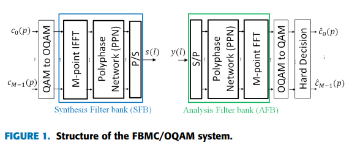
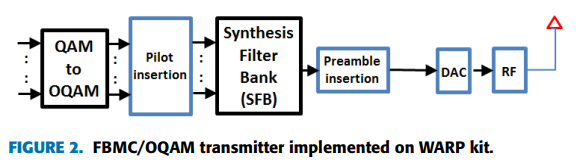
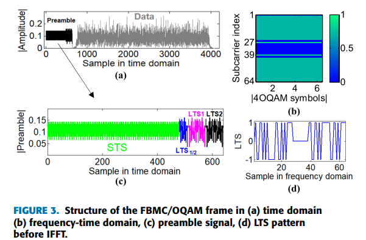
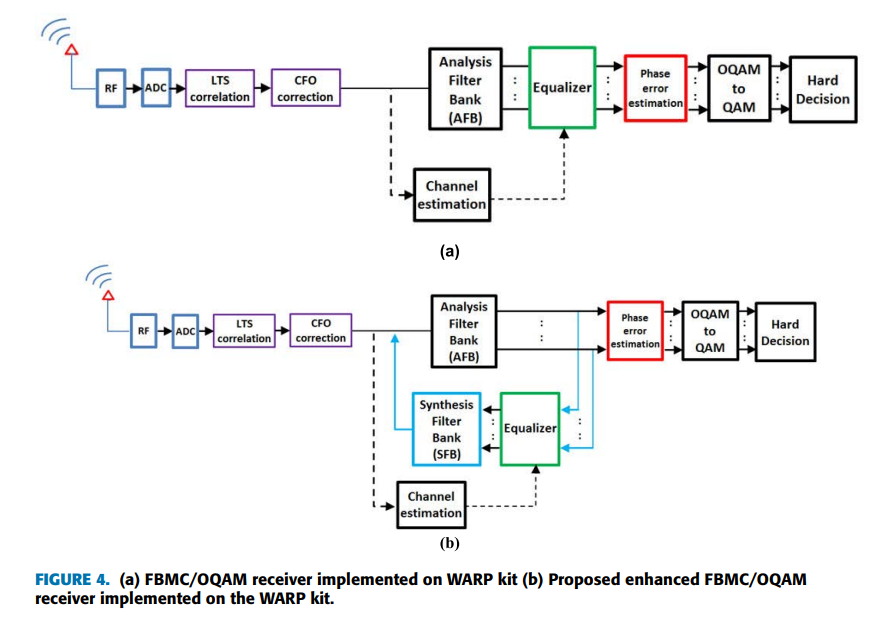
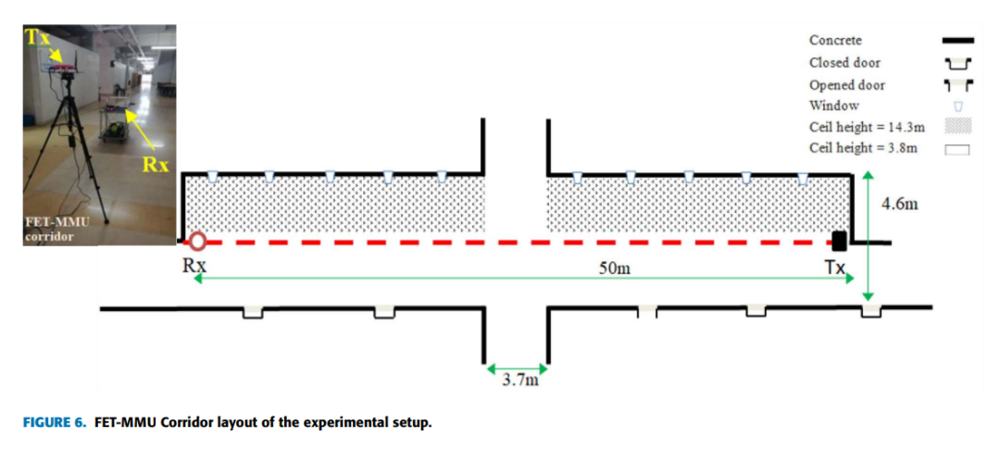
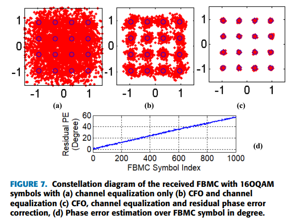
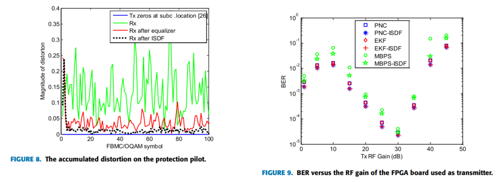
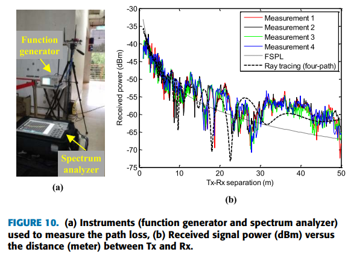
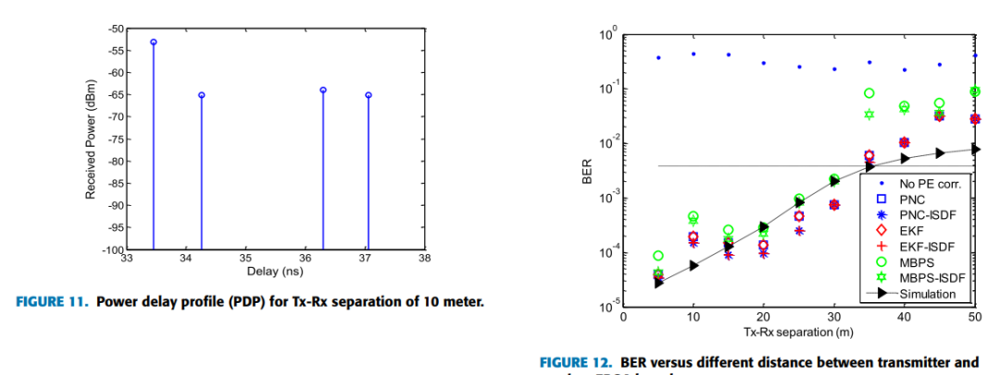
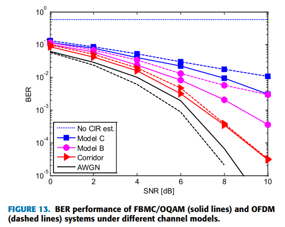
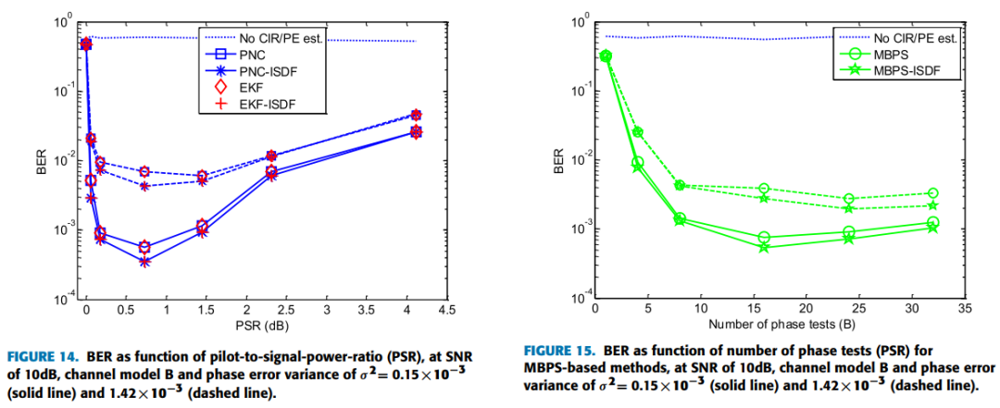

<!-- PAYMENT_BLOCK -->

## Get this dataset

- Payment link (Stripe): [Buy now](https://buy.stripe.com/3cs8yP7sY87d0vu9AB)
- Payment QR code: 

<!-- /PAYMENT_BLOCK -->
